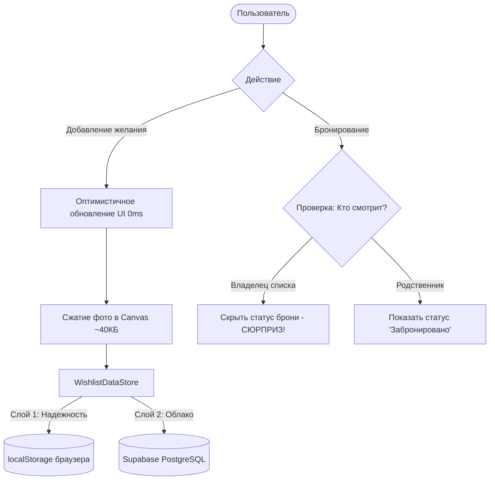

# 🎁 Семейный Вишлист (Family Wishlist)

[](https://nextjs.org/)
[](https://react.dev/)
[](https://www.typescriptlang.org/)
[](https://tailwindcss.com/)
[](https://supabase.com/)
[](https://ditam1233.github.io/family-wishlist/)

> Элегантный, минималистичный веб-сервис семейных списков желаний с умным анти-спойлером, мгновенным сжатием фото, парсингом товаров и поддержкой темной темы.

🔗 **Демо онлайн:** [https://ditam1233.github.io/family-wishlist/](https://ditam1233.github.io/family-wishlist/)  
📦 **Репозиторий:** [https://github.com/ditam1233/family-wishlist](https://github.com/ditam1233/family-wishlist)

---

## 📖 О проекте

**Семейный Вишлист** решает частую проблему праздников и дней рождения: *«Что подарить?»* и *«Как сделать сюрприз, не подарив одно и то же дважды?»*. 

Сервис позволяет членам семьи вести свои списки подарков, делиться ими в рамках закрытых семейных групп и тайно бронировать подарки друг друга.

---

## 🌟 Ключевые возможности

### 1. 🛡️ Система секретного бронирования («Анти-спойлер»)
* **Полный сюрприз для именинника:** Владелец вишлиста никогда не видит статус бронирования своих подарков (для него карточка всегда открыта).
* **Защита от дублей для родственников:** Другие члены семьи видят отметку *«Уже забронировано»* (или *«Забронировано мной»*), что исключает покупку одинаковых подарков несколькими людьми.
* **Вкладка «Мои брони»:** Персональный раздел со всеми подарками, которые вы пообещали подарить близким.

### 2. ⚡ Умный клиентский парсер ссылок (Scraper)
Работает полностью автономно в браузере (включая статический экспорт GitHub Pages):
* **Wildberries Direct CDN:** Автоматический расчет номера корзины по формуле объема (`basket-XX.wbbasket.ru`) — мгновенно подгружает оригинальное фото товара без блокировок и внешних прокси.
* **Ozon & Маркетплейсы:** Автоматическое извлечение названий товаров из URI-слагов с очисткой от маркетингового мусора (*«купить по выгодной цене...»*).
* **Multi-Tier Fallback:** Связка из локального API, **Microlink API** (OpenGraph, Twitter Cards, Microdata) и CORS-прокси гарантирует успешное распознавание любых интернет-магазинов.

### 3. 📸 Мгновенное сжатие фото (HTML5 Canvas)
* Возможность как указать ссылку на картинку, так и загрузить фото напрямую из галереи смартфона или с камеры.
* Встроенный компрессор на базе HTML5 Canvas пережимает тяжелые 5–15 МБ снимки с мобильных камер до оптимизированных **~35–50 КБ** за доли секунды.
* Нулевая задержка отображения, экономия трафика и высокая скорость загрузки.

### 4. 🌓 Темы оформления и дизайн в стиле iOS
* **Светлая и тёмная тема:** Переключатель в шапке сайта с автоматическим сохранением предпочтений в `localStorage`.
* **Эстетика Apple / Modern Clean:** Типографика на базе Geist Sans, аккуратные скругления, акцент на контенте и валюта в рублях (₽).
* **Мобильная шторка («Семья»):** На смартфонах переключение семейных групп открывается в виде удобного нижнего модального окна (Bottom Sheet).
* **Тактильные микро-анимации:** Обратная связь при кликах (`active:scale-95`), плавные переходы между списками родственников и праздничный конфетти-салют при добавлении желания.

### 5. 👨‍👩‍👧‍👦 Семейные группы и гибкий вход
* **Вход по коду семьи:** Новый участник просто вводит короткий код (например, `ФЭМ-3031`) и своё имя — детерминированный алгоритм автоматически подключает его к семье.
* **Классический вход:** Возможность входа и регистрации по Email и паролю.
* **Несколько семей:** Пользователь может одновременно состоять в нескольких группах (семья родителей, своя семья, друзья).

### 6. 🎓 Интерактивный онбординг
* При первом входе новичка встречает пошаговое краткое обучение с иллюстрациями ключевых функций (добавление, секретная бронь, переключение между родственниками).

### 7. 💾 Отказоустойчивая архитектура (Offline-First & Hybrid)
* Основная синхронизация через облачную базу данных **Supabase (PostgreSQL)** с настроенными политиками Row Level Security (RLS).
* Автоматический локальный кэш (`localStorage`): при любых перебоях сети, задержках или сбоях токены и желания пользователя сохраняются локально и объединяются с удаленной базой.

---

## 🛠️ Стек технологий

| Технология | Назначение |
|---|---|
| **[Next.js 16](https://nextjs.org/)** (App Router) | React-фреймворк, гибридный рендеринг и статический экспорт (`output: 'export'`) |
| **[React 19](https://react.dev/)** | Библиотека пользовательского интерфейса, хуки и оптимистичные обновления |
| **[TypeScript 5](https://www.typescriptlang.org/)** | Строгая статическая типизация данных и моделей |
| **[Tailwind CSS v4](https://tailwindcss.com/)** | Современные атомарные стили и поддержка темной темы |
| **[Supabase](https://supabase.com/)** | Облачная база данных PostgreSQL, Auth и Row Level Security |
| **[Lucide React](https://lucide.dev/)** | Стильные лаконичные SVG-иконки |
| **[Canvas-Confetti](https://www.npmjs.com/package/canvas-confetti)** | Анимация конфетти при добавлении желаний |
| **[GitHub Actions](https://github.com/features/actions)** | Непрерывная интеграция и авто-деплой на GitHub Pages |

---

## 📂 Структура проекта

```text
WishList/
├── .github/
│   └── workflows/
│       └── nextjs.yml          # CI/CD пайплайн сборки и деплоя на GitHub Pages
├── src/
│   ├── app/
│   │   ├── api/scrape-link/    # Серверный эндпоинт парсера ссылок (для dev-режима)
│   │   ├── globals.css         # Стили Tailwind CSS и системные переменные
│   │   ├── layout.tsx          # Корневой макет приложения и метаданные
│   │   └── page.tsx            # Главная страница: логика списков, переключения, UI
│   ├── components/
│   │   ├── AddWishModal.tsx    # Модальное окно создания желания (фото, ссылки, цены)
│   │   ├── AuthScreen.tsx      # Экран входа (по коду семьи или через Email)
│   │   ├── EditWishModal.tsx   # Редактирование параметров подарка
│   │   ├── FamilyDrawer.tsx    # Боковая панель / мобильная шторка выбора семей
│   │   ├── InlineAddWish.tsx   # Быстрая строка добавления на лету с автопарсингом
│   │   ├── OnboardingModal.tsx # Обучающий тур для новых пользователей
│   │   ├── ThemeToggle.tsx     # Переключатель светлой и темной темы
│   │   ├── WishCard.tsx        # Карточка подарка в виде сетки
│   │   └── WishRow.tsx         # Компактная строка подарка в виде списка
│   ├── lib/
│   │   ├── data.ts             # Единый DataStore: гибридный слой Supabase + localStorage
│   │   ├── imageCompressor.ts  # Сжатие изображений через HTML5 Canvas
│   │   ├── scraper.ts          # Мульти-уровневый парсер (WB, Ozon, Microlink, CORS)
│   │   └── supabase.ts         # Инициализация клиента Supabase
│   └── types/
│       └── index.ts            # Интерфейсы User, FamilyGroup, Wish, Reservation
├── supabase/
│   └── schema.sql              # SQL-схема таблиц, внешних ключей и политик RLS
├── next.config.ts              # Конфигурация Next.js, статический экспорт и базовый путь
└── package.json                # Зависимости и npm-скрипты
```

---

## 🚀 Установка и локальный запуск

### Требования
* **Node.js** версии 18+ (рекомендуется 20 LTS или новее)
* **npm** или **yarn**

### 1. Клонирование репозитория
```bash
git clone https://github.com/ditam1233/family-wishlist.git
cd family-wishlist
```

### 2. Установка зависимостей
```bash
npm install
```

### 3. Настройка переменных окружения (опционально)
Проект готов к работе сразу в локальном режиме. Для подключения к облачной базе создайте файл `.env.local`:

```env
NEXT_PUBLIC_SUPABASE_URL=https://your-project.supabase.co
NEXT_PUBLIC_SUPABASE_ANON_KEY=your-anon-key-here
```

### 4. Запуск локального сервера разработки
```bash
npm run dev
```
Откройте в браузере: [http://localhost:3000](http://localhost:3000)

### 5. Сборка продакшн-версии
```bash
npm run build
```

---

## 🔄 Схема работы данных (Архитектура)



---

## 🚢 Деплой на GitHub Pages

Проект полностью настроен для автоматического деплоя на **GitHub Pages** с помощью GitHub Actions:

1. При каждом коммите в ветку `main` запускается workflow `.github/workflows/nextjs.yml`.
2. Код собирается статически (`output: 'export'`) с корректным базовым путем `/family-wishlist`.
3. Артефакты сборки автоматически публикуются в окружение GitHub Pages.

---

## 📄 Лицензия

Распространяется под лицензией MIT. Создано с заботой о семейных праздниках и сюрпризах! ❤️
